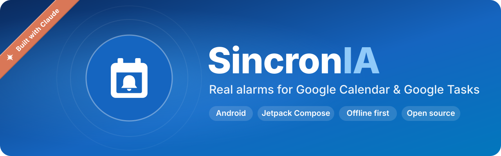

<div align="center">



**一款带有真正闹钟的 Android 日程应用，与 Google 日历和 Google Tasks 双向同步。**

[](LICENSE)


🌐 [English](README.md) · **中文** · [हिन्दी](README.hi.md) · [Español](README.es.md) · [العربية](README.ar.md) · [Português](README.pt-BR.md)

</div>

---

Google 日历的提醒很容易被忽略：一声通知、一下振动，就过去了。SincronIA 把你的日程和任务变成**真正能叫醒你的闹钟**：在锁屏上全屏显示，即使在静音和"勿扰"模式下也会响铃，并提供"稍后提醒"和"关闭"。你在应用中创建或编辑的一切都会同步回 Google，你在 Google 上的修改也会出现在应用中。

> **注意：** 应用界面目前为巴西葡萄牙语。欢迎贡献翻译！

## 功能

- **今天**页面：问候语、逾期任务、全天事项、带"现在"标记的时间线，以及当天已完成的任务。
- **日程**（一周日期条 + 当天列表）和**任务**（所有 Google Tasks 列表，包括子任务）。
- **创建、编辑、删除**日程和任务，并与 Google 双向同步。
- **真正的闹钟**：手机锁屏时全屏显示，使用手机时以带"稍后提醒/关闭"的通知出现，静音模式下也会响铃；重启手机、更新应用或更改时区后闹钟依然有效。
- 一次性关闭**整个重复系列**的闹钟。
- **离线优先**：修改会进入队列，网络恢复后自动上传。
- 设置：新日程的默认闹钟、稍后提醒时长、闹钟铃声、无时间任务的每日提醒、同步间隔、权限快捷入口，以及不含个人数据的诊断导出。

## 隐私

- **没有后端服务器。** 应用直接调用 Google 日历和 Google Tasks 的 API，不存在 SincronIA 服务器。
- 只使用两个授权范围：`calendar.events` 和 `tasks`。没有 API key，也没有 client secret。
- 你的数据保存在手机上（Room + DataStore）。Android 备份已关闭，日志中从不包含令牌、邮箱或日程标题。
- "断开连接"会撤销访问权限、取消闹钟并删除本地数据。

## 即将登陆 Google Play

> 🚀 我们计划在 Google Play 上免费发布 SincronIA，供所有人使用。在此之前，你可以自行构建（见下文）。

## 使用方法

1. 打开应用并**使用 Google 账号登录**，允许访问日历和任务。
2. 当应用请求时，允许**通知**和**全屏闹钟**。如有遗漏，**今天**页面上的横幅会显示快捷入口。
3. 你的日程和任务会显示在**今天**、**日程**和**任务**页面。在"今天"页面下拉即可立即同步。
4. 点击 **+** 创建日程或任务，并选择闹钟响起的时间：开始时或提前几分钟（任务可设置具体时间）。
5. 闹钟响起时，点击**稍后提醒**或**关闭**。在**设置**中可以修改默认闹钟、稍后提醒时长、铃声和同步间隔。

> 💡 为了让闹钟和同步永不延迟，请在手机设置中将本应用的电池使用设为**不受限制**。

## 自行构建

要求：Android Studio（或 JDK 17+）和 Android SDK（compileSdk 37）。应用支持 Android 8.0（API 26）及以上版本。

```bash
git clone https://github.com/GustavoHRX/sincronia.git
cd sincronia
./gradlew assembleDebug test lint
```

- **演示模式（无需 Google 账号）：** 安装 debug 版本，点击 **"Entrar em modo demonstração"**。应用会自动填充示例日程和任务。
- **使用 Google 登录：** 在 Google Cloud 中创建你自己的 OAuth 客户端（一个使用你的 debug SHA-1 的 *Android* 客户端和一个 *Web* 客户端），启用 Calendar 和 Tasks API，并把 Web 客户端 ID 写入 `local.properties`：

  ```properties
  GOOGLE_WEB_CLIENT_ID=123456789-abc.apps.googleusercontent.com
  ```

  详细步骤见 [`docs/ESPECIFICACAO.md`](docs/ESPECIFICACAO.md) 第 3.2 节。使用 `./gradlew signingReport` 获取你的 SHA-1。
- **Release 版本：** 在项目根目录创建 `key.properties`，指向你自己的 keystore（`storeFile`、`storePassword`、`keyAlias`、`keyPassword`）。没有它时，`assembleRelease` 会生成未签名的 APK。

> 切勿提交 `local.properties`、`key.properties`、keystore、`google-services.json` 或 `client_secret*.json`。`.gitignore` 已经屏蔽了这些文件。

## 技术栈

Kotlin · Jetpack Compose + Material 3 · Hilt · Room · DataStore · WorkManager · Retrofit + OkHttp + kotlinx.serialization · Credential Manager + `AuthorizationClient` · `AlarmManager.setAlarmClock()`

```
app/src/main/java/com/sincronia/app/
├── alarm/       闹钟接收器、前台服务、全屏界面、通知
├── core/        登录、数据库（Room）、网络（Google API）、闹钟计算、日志
├── data/        仓库、同步流程（队列 + 下载）、设置、演示数据
├── navigation/  导航
└── ui/          今天、日程、任务、编辑器、设置、引导、权限
```

## 文档（葡萄牙语）

| 文件 | 内容 |
|---|---|
| [`docs/ESPECIFICACAO.md`](docs/ESPECIFICACAO.md) | 完整规格：架构、同步规则、闹钟 |
| [`docs/DECISOES.md`](docs/DECISOES.md) | 决策和与规格的偏差，包含日期和原因 |

## 参与贡献

欢迎提交 issue 和 pull request。请参阅 [`CONTRIBUTING.md`](CONTRIBUTING.md)。

## 许可证

[MIT](LICENSE) © GustavoHRX
